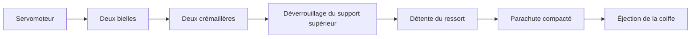

# Micro-fusée expérimentale

Ce dépôt rassemble la conception des différents sous-systèmes de la micro-fusée : propulsion, structure et récupération. Le travail en cours porte sur un éjecteur de coiffe compact destiné à libérer le parachute.

## Problème d’intégration

Le mécanisme doit éjecter la coiffe tout en laissant suffisamment de place au parachute replié. L’espace disponible est très limité : l’enveloppe extérieure du modèle mesure 44 mm de diamètre pour 40 mm de hauteur, avec un passage central de 38,2 mm.

Cette contrainte conduit à placer la transmission autour du passage central plutôt qu’au milieu. Le ressort travaille suivant l’axe de la fusée, tandis que la commande est repoussée vers les parois.

## Évolution du mécanisme

### Première configuration : train d’engrenages

La première étude utilisait plusieurs roues dentées pour transformer la rotation du servomoteur en deux translations opposées. Elle permettait de retirer les deux crémaillères de façon synchronisée, mais occupait une place importante dans la partie basse du mécanisme et multipliait les pièces intermédiaires.

### Deuxième configuration : deux bielles

La deuxième étude conserve le même ressort, le même support supérieur et les deux zones de verrouillage, mais remplace le train d’engrenages inférieur par deux bielles. Le palonnier du servomoteur distribue directement le mouvement aux deux côtés du mécanisme.

Ce changement vise trois objectifs :

- dégager davantage le volume central réservé au parachute ;
- réduire le nombre de renvois mécaniques ;
- rendre le chemin de transmission plus simple à observer et à régler.

## Principe retenu

1. Le bas du ressort s’appuie sur une pièce fixe.
2. Le haut du ressort est retenu par un support supérieur, représenté en rouge dans le modèle.
3. Ce support est clipsé entre deux crémaillères opposées.
4. Un servomoteur entraîne deux bielles depuis un palonnier commun.
5. Lorsque leurs zones d’appui disparaissent, le support supérieur est libéré.
6. Le ressort se détend rapidement et pousse le parachute compacté.
7. Le parachute transmet l’effort à la coiffe, maintenue juste assez pour rester en place avant la commande.

## Démarche de conception

### 1. Réserver le volume utile

Le diamètre du parachute est traité comme une contrainte de départ. Le mécanisme est ensuite construit autour de ce passage afin que l’ajout de la commande ne réduise pas progressivement le volume disponible.

### 2. Maintenir l’énergie sans pièce transversale encombrante

Le support rouge retient le ressort en position armée. Les deux crémaillères créent deux appuis opposés et compacts. Leur mouvement latéral permet de libérer la pièce sans ajouter un verrou occupant tout le diamètre.

### 3. Commander les deux côtés

Le palonnier met simultanément en mouvement deux bielles. Leur longueur et la position de leurs articulations déterminent la course obtenue sur chaque côté. Cette géométrie devra être réglée pour éviter qu’un verrou se libère nettement avant l’autre.

### 4. Préparer la validation réelle

La CAO vérifie l’encombrement et la cinématique nominale, mais le prototype devra encore mesurer :

- les jeux des axes de bielles et le frottement des crémaillères ;
- la course réellement nécessaire au déclipsage ;
- la force du ressort comprimé ;
- le comportement avec le parachute réellement plié ;
- la répétabilité après plusieurs cycles ;
- la tenue de la coiffe avant la commande et sa libération au bon moment.

## Dimensions actuelles du modèle

| Caractéristique | Valeur |
|---|---:|
| Diamètre de travail | Ø44 mm |
| Transmission | Deux bielles |
| Commande | Un servomoteur |
| État | Deuxième étude CAO, prototype à réaliser |

Ces valeurs décrivent l’état actuel du modèle Fusion. Elles seront révisées après les essais de montage, de friction et de répétabilité.

## État du projet

- architecture générale modélisée ;
- deuxième chaîne cinématique modélisée avec deux bielles ;
- vues et synthèse dimensionnelle produites ;
- prototype et choix définitif du ressort à réaliser ;
- essais avec parachute et coiffe à documenter.

Le dossier illustré et les plans sont visibles sur [la page micro-fusée du portfolio](https://paul-n7-3ea-eportfolio.vercel.app/micro-fusee.html).
