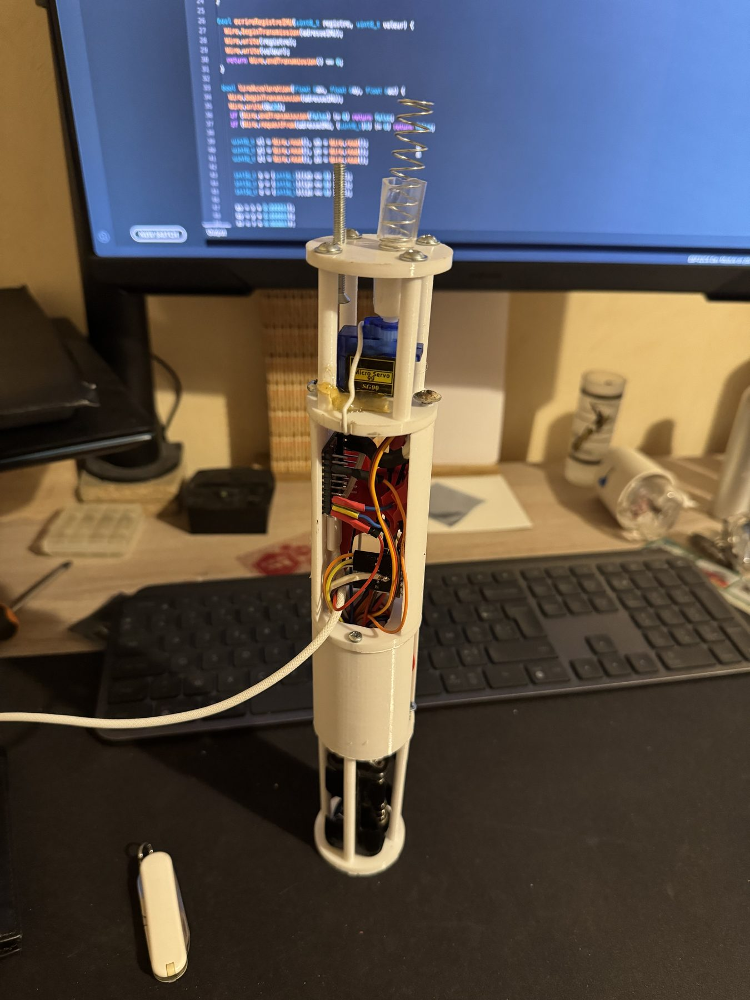
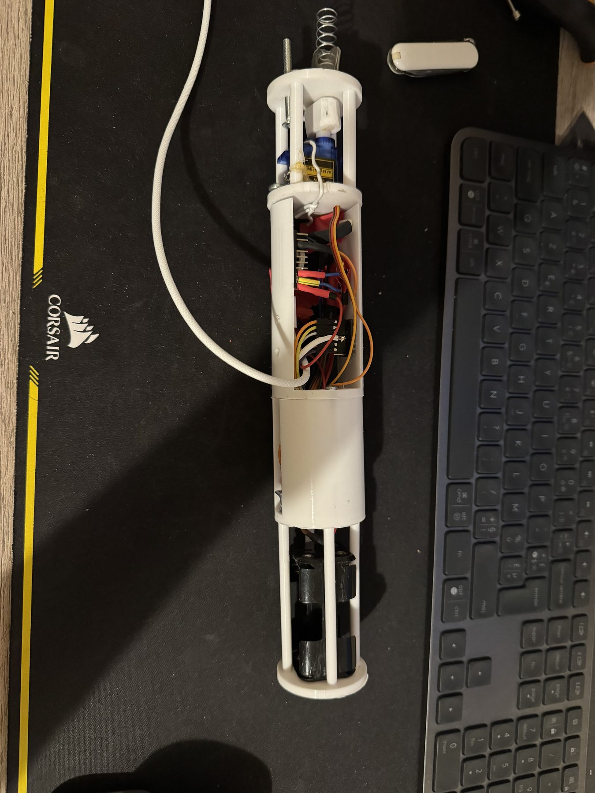
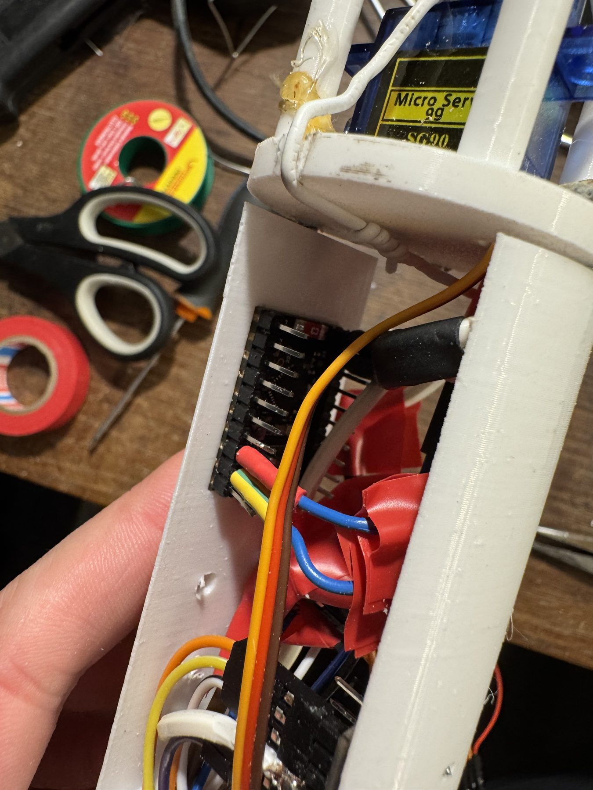
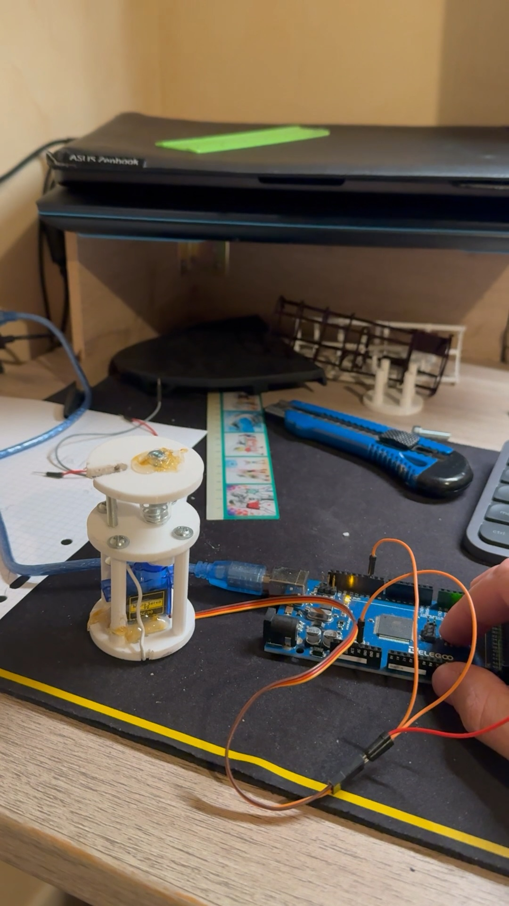
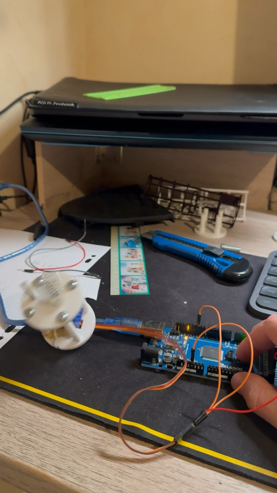
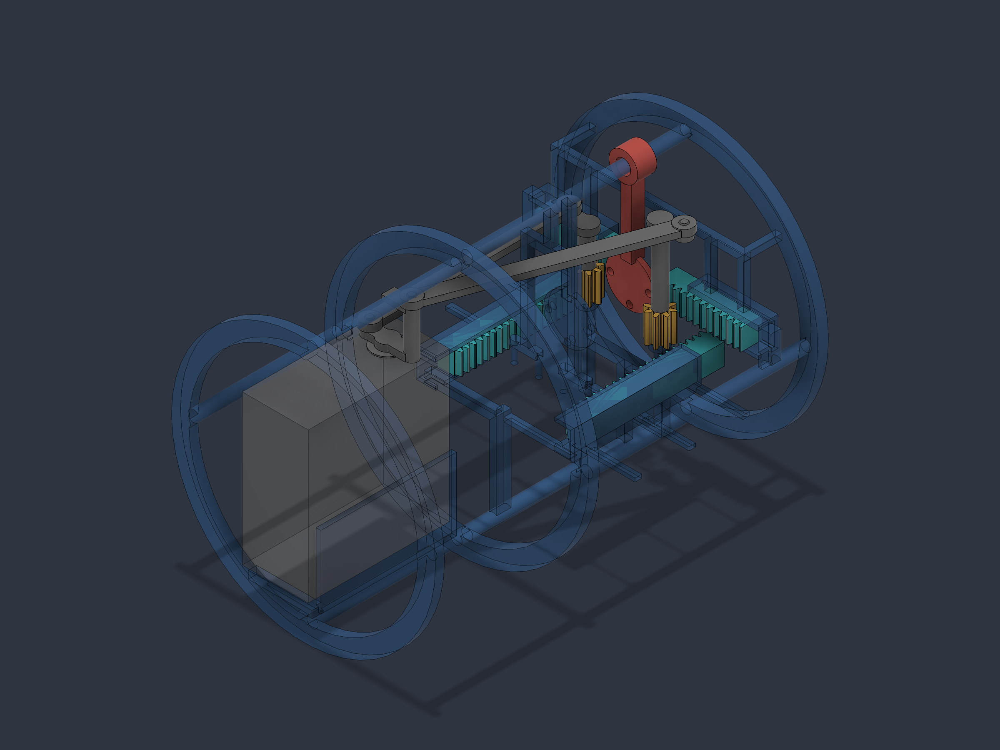
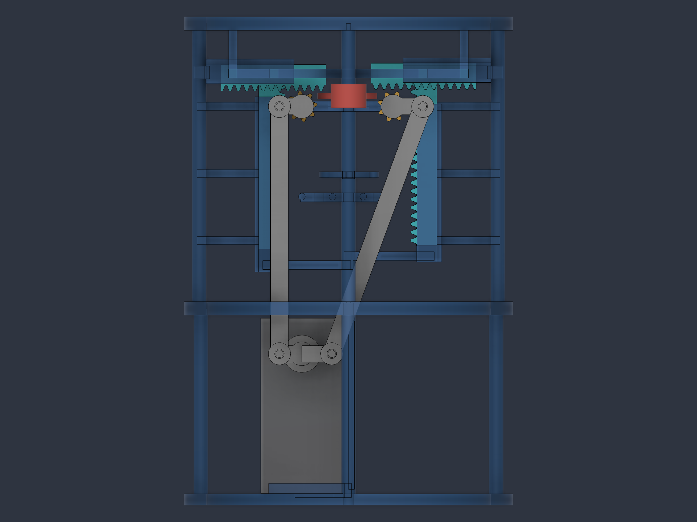

# Micro-fusée expérimentale

Ce dépôt documente le développement progressif d’une micro-fusée de **800 mm** : étude de performances, structure, avionique embarquée et récupération par parachute. Le projet est encore en phase de prototypage ; les valeurs de propulsion sont des prévisions de modèle et les essais photographiés sont des validations sur table.

## Vue d’ensemble

| Sous-système | État actuel |
|---|---|
| Cellule | Longueur maintenue à 800 mm |
| Propulsion | Deux scénarios théoriques comparés dans OpenRocket |
| Avionique | ESP32-C6, baromètre BMP280 et accéléromètre intégrés |
| Acquisition | Enregistrement des mesures en cours de validation |
| Récupération | Verrou à ressort commandé par micro-servomoteur, testé sur table |

L’objectif de conception est de réunir l’électronique et la récupération dans un diamètre réduit sans empêcher le rangement du parachute ni l’accès aux connexions.

## Étude théorique

La longueur de la fusée reste identique dans les deux scénarios ; seule la longueur du moteur étudié évolue.

| Scénario | Longueur moteur | Durée prévue | Poussée prévue | Impulsion prévue | Masse moteur estimée |
|---|---:|---:|---:|---:|---:|
| Essai | 120 mm | 3,69 s | 35,2 à 102,2 N | 236 N·s | 0,390 kg |
| Vol étudié | 200 mm | 3,22 s | 67,1 à 194,9 N | 394 N·s | 0,550 kg |

Ces chiffres décrivent l’état du modèle et ne sont ni des mesures de banc ni des résultats de vol. Avant d’utiliser ces scénarios, il reste à recalculer l’impulsion depuis les courbes temporelles complètes, mesurer la masse et le centre de gravité de la fusée assemblée, puis réinjecter ces données dans OpenRocket.

## Avionique embarquée

L’architecture retenue associe :

- un **ESP32-C6** pour l’acquisition et la logique de vol ;
- un **BMP280** détecté à l’adresse I²C `0x76` pour suivre la pression et estimer l’altitude ;
- un **accéléromètre** détecté à l’adresse `0x6B` pour enregistrer la dynamique du vol ;
- un **SG90** pour commander le verrou du mécanisme de récupération ;
- une alimentation séparée pour le servomoteur, avec masse commune avec l’ESP32.

Le câblage a d’abord été testé sur table, puis rangé dans une structure imprimée en 3D. Cette progression a permis de vérifier l’accès USB, le passage des conducteurs et la place réservée au ressort et à l’alimentation.

### Points déjà vérifiés

- détection répétée du BMP280 et de l’accéléromètre sur le bus I²C ;
- génération du signal PWM de commande du servomoteur ;
- intégration physique des cartes, de l’alimentation et du mécanisme ;
- conservation d’un accès aux connecteurs pour les essais et corrections.

### Points restant à valider

- tenue des connexions sous vibrations ;
- stabilité de l’alimentation lors de l’actionnement du servo ;
- enregistrement continu d’une séquence complète ;
- détection fiable de l’apogée ;
- répétabilité du déploiement avec parachute et coiffe montés.

## Système de récupération actuel

Le prototype physique actuellement testé n’utilise plus le train d’engrenages de la première étude CAO. Il empile trois fonctions dans l’axe de la fusée : guidage, stockage d’énergie par ressort et verrouillage commandé.

1. Le ressort est comprimé entre un plateau fixe et la partie mobile.
2. Un verrou latéral retient le plateau supérieur en position armée.
3. Le micro-servomoteur déplace ce verrou.
4. Une fois le verrou dégagé, le ressort restitue son énergie et projette la partie mobile.
5. Dans la configuration finale, ce mouvement doit libérer la coiffe et permettre le déploiement du parachute.

La vidéo et les photographies confirment la libération rapide du plateau sur table. Elles ne démontrent pas encore le déploiement complet : le parachute compacté et la coiffe doivent encore être intégrés aux essais répétitifs.

## Études CAO précédentes

Avant le prototype concentrique, plusieurs transmissions ont été explorées pour dégager le volume central. La variante à deux bielles reste utile pour comprendre les compromis d’encombrement et de synchronisation, mais elle ne correspond plus au mécanisme physique actuellement assemblé.

### Problème d’intégration de cette étude

Le mécanisme doit éjecter la coiffe tout en laissant suffisamment de place au parachute replié. L’espace disponible est très limité : l’enveloppe extérieure du modèle mesure 44 mm de diamètre pour 40 mm de hauteur, avec un passage central de 38,2 mm.

Cette contrainte conduit à placer la transmission autour du passage central plutôt qu’au milieu. Le ressort travaille suivant l’axe de la fusée, tandis que la commande est repoussée vers les parois.

### Évolution de cette étude

### Première configuration : train d’engrenages

La première étude utilisait plusieurs roues dentées pour transformer la rotation du servomoteur en deux translations opposées. Elle permettait de retirer les deux crémaillères de façon synchronisée, mais occupait une place importante dans la partie basse du mécanisme et multipliait les pièces intermédiaires.

### Deuxième configuration : deux bielles

La deuxième étude conserve le même ressort, le même support supérieur et les deux zones de verrouillage, mais remplace le train d’engrenages inférieur par deux bielles. Le palonnier du servomoteur distribue directement le mouvement aux deux côtés du mécanisme.

Ce changement vise trois objectifs :

- dégager davantage le volume central réservé au parachute ;
- réduire le nombre de renvois mécaniques ;
- rendre le chemin de transmission plus simple à observer et à régler.

### Principe étudié

1. Le bas du ressort s’appuie sur une pièce fixe.
2. Le haut du ressort est retenu par un support supérieur, représenté en rouge dans le modèle.
3. Ce support est clipsé entre deux crémaillères opposées.
4. Un servomoteur entraîne deux bielles depuis un palonnier commun.
5. Lorsque leurs zones d’appui disparaissent, le support supérieur est libéré.
6. Le ressort se détend rapidement et pousse le parachute compacté.
7. Le parachute transmet l’effort à la coiffe, maintenue juste assez pour rester en place avant la commande.

### Démarche de conception

### 1. Réserver le volume utile

Le diamètre du parachute est traité comme une contrainte de départ. Le mécanisme est ensuite construit autour de ce passage afin que l’ajout de la commande ne réduise pas progressivement le volume disponible.

### 2. Maintenir l’énergie sans pièce transversale encombrante

Le support rouge retient le ressort en position armée. Les deux crémaillères créent deux appuis opposés et compacts. Leur mouvement latéral permet de libérer la pièce sans ajouter un verrou occupant tout le diamètre.

### 3. Commander les deux côtés

Le palonnier met simultanément en mouvement deux bielles. Leur longueur et la position de leurs articulations déterminent la course obtenue sur chaque côté. Cette géométrie devra être réglée pour éviter qu’un verrou se libère nettement avant l’autre.

### 4. Préparer la validation réelle

La CAO vérifie l’encombrement et la cinématique nominale, mais le prototype devra encore mesurer :

- les jeux des axes de bielles et le frottement des crémaillères ;
- la course réellement nécessaire au déclipsage ;
- la force du ressort comprimé ;
- le comportement avec le parachute réellement plié ;
- la répétabilité après plusieurs cycles ;
- la tenue de la coiffe avant la commande et sa libération au bon moment.

### Dimensions de l’étude CAO

| Caractéristique | Valeur |
|---|---:|
| Diamètre de travail | Ø44 mm |
| Transmission | Deux bielles |
| Commande | Un servomoteur |
| État | Deuxième étude CAO, prototype à réaliser |

Ces valeurs décrivent l’état actuel du modèle Fusion. Elles seront révisées après les essais de montage, de friction et de répétabilité.

## État du projet

- cellule de 800 mm conservée dans les deux scénarios théoriques ;
- acquisition barométrique et inertielle testée sur table ;
- avionique et alimentation intégrées dans le châssis imprimé ;
- verrou à ressort commandé par SG90 fonctionnel sur table ;
- essais répétés avec parachute et coiffe encore à documenter ;
- masse, centre de gravité et stabilité à mesurer sur l’assemblage final.

Le dossier illustré et les plans sont visibles sur [la page micro-fusée du portfolio](https://paul-n7-3ea-eportfolio.vercel.app/micro-fusee.html).
